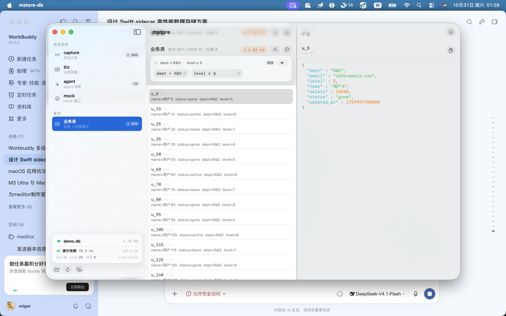
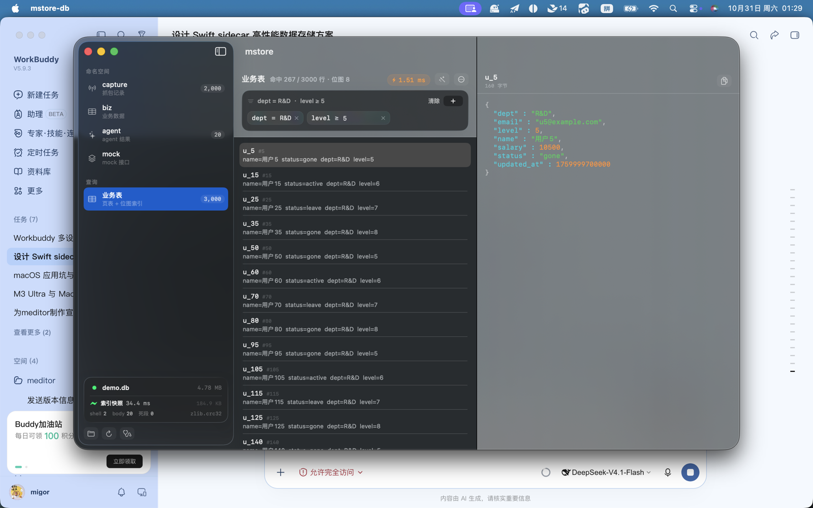
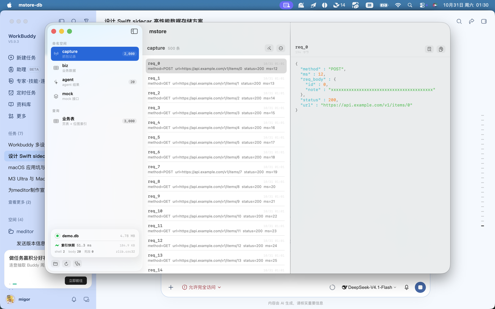
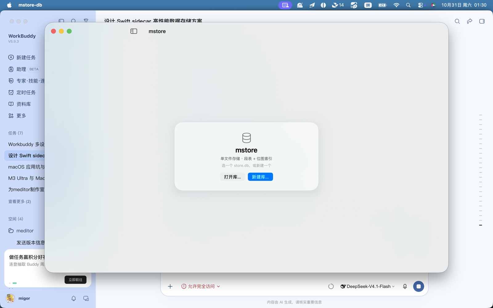

# mstore-db

[`mstore`](https://github.com/migoric/mstore) 的 macOS 客户端。原生 AppKit + SwiftUI，
**没有 WebView、没有 Electron**；所有数据读写交给 `mstore` 的 Node sidecar，App 只负责展示。



**只支持 macOS 26。** 界面建立在 Liquid Glass 之上（`glassEffect` / `GlassEffectContainer` /
`scrollEdgeEffectStyle`），这些 API 在旧系统上不存在。与其在 15 上退化成一堆灰底面板，
不如明确不兼容。

## 功能

**三栏**

| 栏 | 内容 |
|---|---|
| 侧栏 | `biz` / `capture` / `mock` / `agent` 四个命名空间 + 「业务表」入口；底部状态面板显示文件名、大小、**这次走的哪条路**、耗时、快照字节、shell/body/死段、CRC 实现；再下面打开库 / 重新读取 / 自检 |
| 中栏 | 记录列表或业务表行；顶部标题 + 计数 + 延迟徽标 + 造数据 + 更多（自检 / 清空命名空间 / 清空业务表 / 跑压测）。业务表模式下挂查询构建器 |
| 详情 | 选中行 JSON（正则高亮，>200KB 降级纯文本）、body 预览、自检结果 |

**查询构建器**

不发明内核做不到的东西。`mstore` 的 `Filter` 只有四个自由度，UI 就只给五个操作符：

| 操作符 | 符号 | 值的形态 |
|---|---|---|
| 等于 | `=` | 枚举字段下拉（值来自 `biz.stats().enumValues`），数值字段输入框 |
| 属于其一 | `∈` | 逗号分隔多值 |
| 不小于 | `≥` | 数值 |
| 不大于 | `≤` | 数值 |
| 介于 | `↔` | 上下界两个数值 |

字段列表来自内核，App 不硬编码 schema。同一字段被多个条件命中时**后者覆盖前者**——
内核的 `Filter` 每个字段只有一个槽位，界面不偷偷合并，`descriptor` 显示最终生效的条件。
改条件后 120ms 防抖再发请求。

**冷启动仪表盘**

侧栏底部那行是索引快照唯一的可见证据，所以放在第一屏：

```
▮ 索引快照   32.3 ms          184.9 KB
shell 3   body 204   死段 0        zlib.crc32
```

走的若是逐页重放，图标和文字都会换，并显示原因（`no snapshot` / `stale (snap 12 ≠ biz 13)` /
`CRC mismatch` / `snapshot seg 41 missing or dead`）。

**其它**

- 自检：段头、CRC、索引、locator 一次跑完，问题按 error / warn 分级列出
- 清空：按命名空间清空是 O(段数)，一次点击
- 压测：中栏「跑压测」按钮直接驱动内核，不用切终端
- 命令行预置查询：`--filter 'dept=R&D;level>=5'`，用于无人值守验证查询链路

## 性能

数字来自内核实测，客户端只负责把这些暴露出来。本机 Intel i7-1068NG7 / macOS 26。

**查询**（3000 行业务表，`dept=R&D;level>=5` 命中 267 行）

| 项 | 结果 |
|---|---|
| 首帧（含 JIT 预热） | **1.61 ms** |
| 之后每次查询 | 个位数到十几 **µs** |
| 内核位图查询 p50（30k 行） | **8–10 µs** |
| 同条件全表扫（30k 行） | 1.7–2.5 ms |

位图相对全表扫快 **~170–320×**。延迟徽标按耗时染色（<1ms / <10ms / 更慢），不用文字解释。

**冷启动**（`open` 命中索引快照 vs 逐页重放）

| 行数 | 索引快照 | 逐页重放 | 加速 |
|---|---|---|---|
| 3k | **32.3 ms** | 166 ms | 5.1× |
| 30k | 35.9 ms | 159 ms | 4.4× |
| 100k | 178.1 ms | 593.2 ms | 3.3× |

快照大小：3000 行 **184.9 KB**。数值区间查询在 100 万行上命中 0 行时是 **0.02 ms**
（全表扫 6.22 ms）——完整数据见内核 README 的性能节。

## 安装

发布页有 universal（arm64 + x86_64）zip。

1. 解压 `mstore-db-*.zip`，把 `mstore-db.app` 拖进「应用程序」
2. **首次打开要右键 →「打开」**：包是 ad-hoc 签名（无开发者账号），Gatekeeper 会拦双击。只需一次
3. 把内核放在 `mstore-db.app` 同级目录：

```
应用程序/
├── mstore-db.app
└── mstore/            # git clone https://github.com/migoric/mstore
```

也可以用环境变量指定：`MSTORE_CLI=/path/to/mstore/cli.ts`、`MSTORE_NODE=$(which node)`。
都找不到时窗口里会直接告诉你设哪个变量，不用翻日志。

需要 macOS 26+、Node ≥ 22.18。

## 从源码构建

```bash
git clone https://github.com/migoric/mstore.git ../mstore
cd ../mstore && node bench/demo.ts --biz 3000 --cap 2000 --runs 20 && cd -

swift build
.build/debug/mstore-db ../mstore/data/demo.db

./tools/bundle.sh              # 出 dist/mstore-db.app（universal + ad-hoc 签名）
swift test --disable-sandbox
```

启动参数：

| 参数 | 作用 |
|---|---|
| `<库路径>` | 要打开的库。不给则显示居中的连接卡（打开库… / 新建库…） |
| `--table` | 直接进「业务表」视图，而不是 KV 记录列表 |
| `--filter` | 预置查询条件，形如 `dept=R&D;level>=5;status=active,leave` |
| `--dark` | 强制深色外观 |

## 协议

客户端只认这些 op（完整表见内核 README「stdio 协议」）：

```text
hello                              启动时主动推 {pid, crc, stats}
info / check                       库统计 / 自检
list / get / body                  记录、值、body（前 4KB，base64）
put / putbody / clear              KV 写入与按 ns 清空
biz.info / biz.query               页表与位图统计 / 位图查询
biz.get / biz.put / biz.del / biz.clear
backup / quit
```

`biz.query` 返回 `{matched, took_us, rows:[{key, rowid, value}]}`——`matched` 是全量命中数，
`rows` 只是前 `limit` 条，界面据此显示「命中 267 / 3000 行」。

退出走 `applicationShouldTerminate` 返回 `.terminateLater`，先 `await client.close()` 再放行：
**meta 和索引快照都写在 close 里**，直接 terminate 会丢掉最后一个快照，下次启动退回逐页重放。

## 截图

| 业务表（浅色） | 业务表（深色） |
|---|---|
|  |  |

| KV 记录 | 未连接 |
|---|---|
|  |  |

## 已知限制

- **只读**：界面不做写入编辑。写路径在 sidecar 里已实现（`biz.put` / `biz.del` 等），只是没接编辑控件
- **列表不虚拟化**：几千行会卡，上限由查询 `limit` 挡住（默认 300）
- **JSON 高亮有 200KB 上限**：超过就不着色，避免大 body 卡住主线程
- **body 用 base64 过通道**：演示够用。真传 5MB 对象应只传 `{off, len}` 让 Swift 自己读盘
- **一次只连一个库**：换库要先关掉当前的 sidecar
- **无沙盒 / 无公证**：ad-hoc 签名的包，首次打开需右键

## 相关

- 内核：[`github.com/migoric/mstore`](https://github.com/migoric/mstore)
- [`docs/ui-notes.md`](docs/ui-notes.md)——为什么用 stdio、Liquid Glass 实测结论、目录边界
- [`docs/design.md`](docs/design.md)——内核设计总纲
- 贡献与约定：[`AGENTS.md`](AGENTS.md) / [`CONTRIBUTING.md`](CONTRIBUTING.md)

## 许可

MIT
